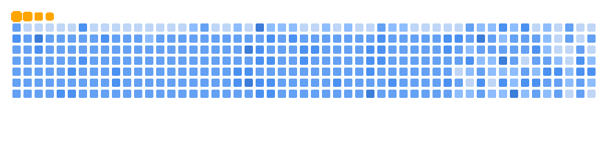

# Hi, I'm Manish Kandari 👋

### Web development · Developer tools · Go

Building useful projects, exploring backend systems, and learning through code.

[LinkedIn](https://linkedin.com/in/manish-singh-kandari) · [LeetCode](https://www.leetcode.com/manishkandari09) · [Email](mailto:manishkandari168@gmail.com)

---

## 👨‍💻 Behind the code

- **Build:** web interfaces, browser extensions, and developer utilities.
- **Explore:** Go, backend APIs, and Rust.
- **Practice:** problem solving and data structures with LeetCode.

## 🚀 Selected projects

| Project | What it's about | Stack |
| :--- | :--- | :--- |
| [**LeetSyncX**](https://github.com/manishkandari9/LeetSyncX-3.0) | A browser extension for syncing LeetCode solutions to GitHub. | JavaScript · Chrome extension |
| [**MCP Server**](https://github.com/manishkandari9/mcp-server) | A Go HTTP service for browsing a project's file tree. | Go · REST API |
| [**Responsive Portfolio**](https://github.com/manishkandari9/responsive-portfolio-page) | A personal portfolio page exploring responsive web design. | Web development |

## 🛠️ Toolbox

  

**Web:** JavaScript · TypeScript · React · Next.js · Node.js · Tailwind CSS  
**Backend & data:** Go · Python · Express · MongoDB · PostgreSQL  
**Tools:** Git · GitHub · Docker · Figma

<b>More from my learning journey</b>

- [Go: Basics to Advanced](https://github.com/manishkandari9/Learn-Go-Basics-to-Advanced)
- [Rust To-do List](https://github.com/manishkandari9/Rust_todo-list_)
- [LeetCode Solutions](https://github.com/manishkandari9/leetcode-solutions)
- [Python Library Management](https://github.com/manishkandari9/Library_management_using_python)

## 📈 Contribution activity

## 🔥 Streak & GitHub stats

  

  
  

## 🐍 Contributions in motion

<picture>
  <source media="(prefers-color-scheme: dark)" srcset="https://raw.githubusercontent.com/manishkandari9/manishkandari9/output/github-contribution-grid-snake-dark.svg" />
  <source media="(prefers-color-scheme: light)" srcset="https://raw.githubusercontent.com/manishkandari9/manishkandari9/output/github-contribution-grid-snake.svg" />
  
</picture>

<b>🌊 Watch the ocean animation</b>

---

**Have an idea? Let's build something useful.**

[Connect on LinkedIn](https://linkedin.com/in/manish-singh-kandari) · [Explore my repositories](https://github.com/manishkandari9?tab=repositories) · [Buy me a coffee ☕](https://coff.ee/manishkandari9)

